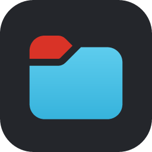
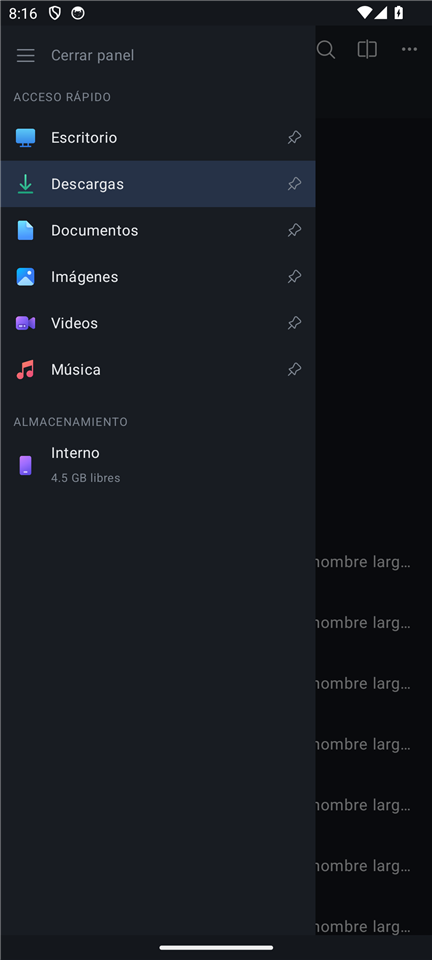
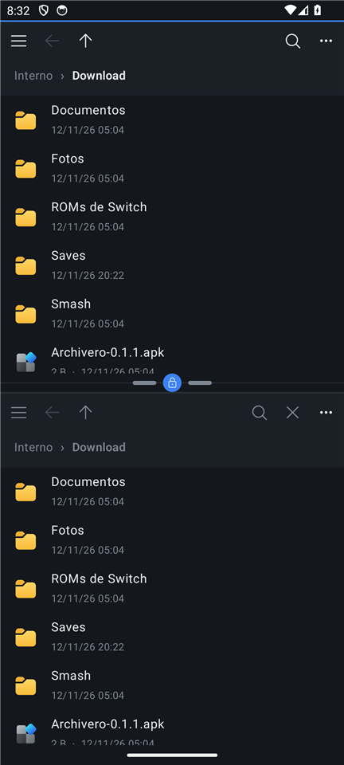
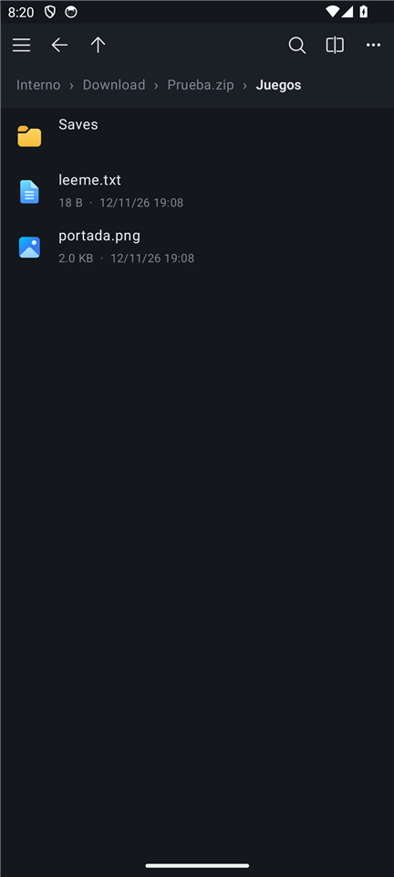

<p align="center"></p>

<h1 align="center">V Files</h1>

<p align="center">
Explorador de archivos para Android, estilo Explorador de Windows.<br>
Sin anuncios, sin cuentas, sin internet. Se maneja con el dedo y con control.
</p>

<p align="center">
<a href="../../releases/latest"><b>Descargar el APK más reciente</b></a> ·
<a href="CHANGELOG.md">Historial de cambios</a>
</p>

<p align="center">



</p>

## Por qué existe

Nació para una consola portátil con Android (el AYN Thor), donde el explorador comercial
mostraba anuncios a media operación y se sentía torpe. V Files tiene lo útil y nada más:
es local, rápido y se puede ir ampliando. Funciona igual en un celular normal.

La app **no pide permiso de internet**: no puede mandar nada a ningún lado.

## Funciones

**Navegar**
- Uno o dos paneles. En horizontal van lado a lado; en vertical, uno arriba del otro.
- Cada panel tiene su propia barra: ☰, atrás, subir, buscar, cerrar y menú, con la ruta
  completa en un renglón aparte (toca cualquier parte de la ruta para saltar ahí).
- División ajustable entre paneles: arrástrala, o usa L2/R2 con el control. Cerca de la
  mitad se pega sola, como un imán. Doble toque la regresa a la mitad. Se puede apagar en ⋮.
- Lista o cuadrícula, miniaturas de imágenes, archivos ocultos opcionales.
- Orden por nombre, fecha, tamaño o tipo, normal o inverso.
- Carpeta de inicio a elegir (⋮ → *Abrir aquí al iniciar*).

**Acceso rápido**
- El ☰ abre, encima del panel, la barra con las carpetas ancladas y el almacenamiento
  (interno y tarjeta SD, con espacio libre).
- De entrada trae Escritorio (si existe), Descargas, Documentos, Imágenes, Videos y Música,
  cada una con su icono. Ancla cualquier carpeta con *Anclar*; mantén presionada una para
  desanclarla, subirla o bajarla.

**Archivos**
- Copiar, cortar y pegar; con dos paneles, *Copiar/Mover al otro panel*.
- Renombrar, nueva carpeta, propiedades (tamaño total, número de archivos, fecha).
- Compartir, abrir, *Abrir con*. Abrir un `.apk` lanza el instalador.
- Papelera propia por volumen: restaurar, borrar o vaciar; lo que lleva 30 días se borra
  solo. También *Borrar definitivo*, sin pasar por la papelera.
- Búsqueda por nombre en la carpeta y sus subcarpetas.
- Conflictos de nombre: omitir, conservar ambos o reemplazar, con *Aplicar a todos*.
- Las operaciones largas siguen en segundo plano con su notificación y se pueden cancelar.
  Copiar nunca deja un archivo a medias: se escribe aparte y se renombra al final.

**Zips**
- Un `.zip` se abre como una carpeta (de solo lectura) y se recorre por dentro.
- Tocar un archivo de adentro lo abre directo.
- *Extraer* deja lo seleccionado junto al zip; *Extraer al otro panel*, en la carpeta del otro lado.
- *Comprimir* crea un `.zip` con lo seleccionado.
- Lee nombres en UTF-8 y en el formato viejo de Windows; ignora entradas que intenten
  salirse de la carpeta de destino.

## Controles

Todo se puede hacer con el control, sin tocar la pantalla.

| Botón | Hace |
|-------|------|
| Cruceta / palanca izquierda | Mover el foco |
| A | Abrir / aceptar |
| B | Atrás (quita la selección, cierra la búsqueda, sube de carpeta) |
| X | Seleccionar lo enfocado |
| Y | Menú de acciones |
| L1 / R1 | Panel izquierdo / derecho |
| L2 / R2 | Achicar / agrandar el panel activo |
| Start | Uno o dos paneles |
| Select | Abrir o cerrar Acceso rápido en el panel activo |

## Instalar

1. Descarga el `.apk` de la [versión más reciente](../../releases/latest).
2. Ábrelo en el aparato; Android pedirá permitir instalar apps de esa fuente.
3. Al abrir V Files, dale permiso de **acceso a todos los archivos** (es un explorador:
   sin eso no puede ver tus carpetas).

Requiere Android 11 o más nuevo.

> **Si tenías "Archivero"** (el nombre anterior, hasta la 0.5.2): V Files se instala como
> una app aparte. Desinstala Archivero; tus archivos no se tocan, solo hay que volver a
> anclar tus carpetas.

## Cómo está hecho

- Kotlin + Jetpack Compose (Material 3). Sin librerías de red.
- Dos módulos:
  - `core/`: Kotlin puro, sin Android. Listar, copiar, mover, papelera, búsqueda, zips y
    la cola de operaciones. Se prueba en la PC con JUnit.
  - `app/`: la interfaz, el control físico, el servicio de operaciones en segundo plano y
    las preferencias (DataStore).
- `core` se compila contra la API de Java 11, así que lo que no existe en Android 11–13
  falla al compilar y no en el aparato.
- Iconos: [Fluent UI System Icons](https://github.com/microsoft/fluentui-system-icons)
  (Microsoft, MIT; ver `tools/fluent-icons/LICENSE.txt`), los mismos de Windows 11. La
  carpeta, el zip, la música, el escritorio y las descargas se arman con la forma de Fluent
  y colores de Windows, porque Fluent no los trae a color.

## Compilar

Requiere JDK 17 y el SDK de Android (plataforma 35). Las rutas van en `env.sh` y
`local.properties`.

```bash
source ./env.sh
./gradlew :core:test :app:testReleaseUnitTest   # pruebas
./gradlew :app:assembleDebug                    # app-debug.apk
./gradlew :app:assembleRelease                  # app-release.apk, reducido y firmado
```

La firma de la versión final usa un almacén de claves fuera del repo; `local.properties`
(que no se sube) dice dónde está:

    vfiles.keystore=D:/ruta/al/almacen.jks
    vfiles.keystore.password=...
    vfiles.key.alias=...

Sin esas líneas se firma con la clave de depuración. Android no deja actualizar una app con
un APK firmado con otra clave.

Para regenerar los iconos: `cd tools/fluent-icons && npm install && python build_icons.py`.

El diseño original y el plan de la primera etapa están en `docs/superpowers/`; la lista de
pruebas en el aparato, en `docs/verificacion-etapa-1.md`.
